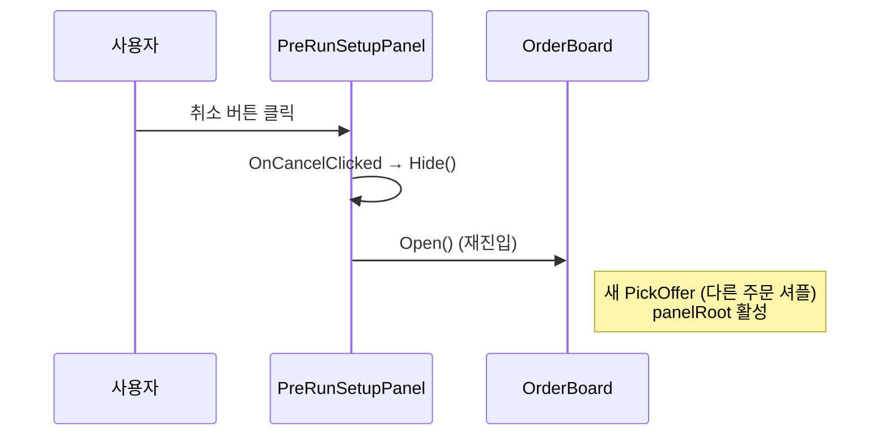
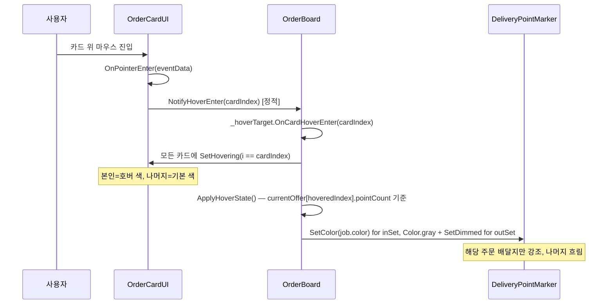
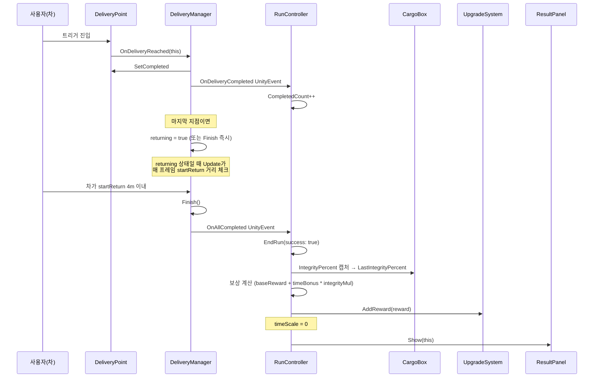
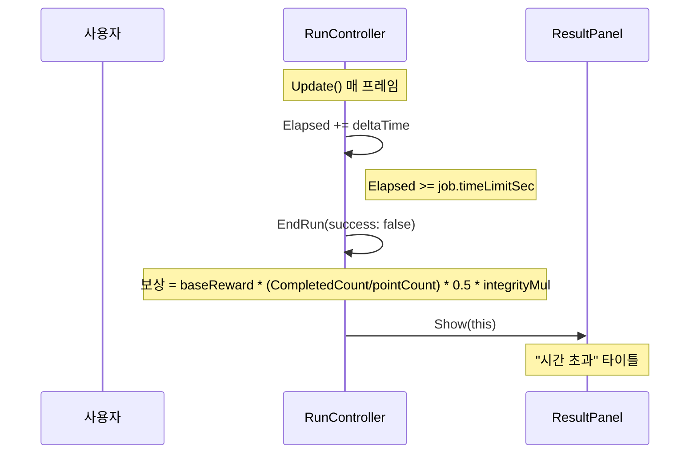

# 코드 흐름 — 사용자 액션 → 함수 사슬

> **읽는 법:** Mermaid 다이어그램은 GitHub, VSCode (Markdown Preview Mermaid Support 확장), Obsidian, mermaid.live에서 렌더.
> 일반 마크다운으로도 읽힘 (텍스트 시퀀스).

---

## Flow 1: 게임 시작 → 출발 (정상 흐름)

```mermaid
sequenceDiagram
    autonumber
    participant U as 사용자
    participant RC as RunController
    participant OB as OrderBoard
    participant OC as OrderCardUI
    participant PSP as PreRunSetupPanel
    participant PC as PackingCardUI
    participant Cargo as CargoBox
    participant DM as DeliveryManager

    U->>RC: 게임 시작
    RC->>RC: Start() → OpenBoard()
    RC->>OB: Open()
    OB->>OB: PickOffer + CacheMarkers
    OB->>OC: Instantiate × 3 + Bind(idx, job, OnCardClicked)
    Note right of OB: panelRoot 활성

    U->>OC: 주문 카드 클릭
    OC->>OB: onCardClicked(idx) [Bind에서 등록한 콜백]
    OB->>OB: lastSelectedJob = currentOffer[idx]
    Note right of OB: panelRoot 비활성
    OB->>PSP: Show(job)
    PSP->>PSP: SpawnCardsIfNeeded (4 카드 1회)
    PSP->>PC: Instantiate × 4 + Bind(tier, OnCardClicked)
    Note right of PSP: panelRoot 활성, Refresh

    U->>PC: 포장 카드 클릭 (예: Foam)
    PC->>PSP: onClicked(Foam) [Bind에서 등록]
    PSP->>PSP: selectedTier = Foam; Refresh()
    Note right of PSP: 카드 SetSelected, totalCost/confirmText 갱신

    U->>PSP: 출발 버튼 클릭
    PSP->>PSP: OnConfirmClicked()
    PSP->>PSP: Hide() — panelRoot 비활성
    PSP->>RC: BeginRun(job, Foam) ★ 오버로드
    RC->>DM: ActivateSubset(job.pointCount)
    RC->>Cargo: SetCargoType(job.cargoType) → ApplyPreset
    RC->>Cargo: SetPacking(Foam ?? job.defaultPacking) ★ 버그 fix
    RC->>OB: Close() — 카드 destroy
    Note over RC: timeScale = 1, 운전 시작
```

**핵심 포인트:**
- 6번 (OB → PSP.Show)에서 **포장 선택 단계 진입**
- 13번 (RC ← BeginRun 오버로드)에서 **selectedTier가 cargo까지 도달** — Phase 2 버그 fix의 결정적 순간

---

## Flow 2: 출발 취소 (PreRunSetupPanel에서 뒤로)



⚠ 의문: timeScale은 OpenBoard에서만 0으로 set됨. PSP.Show 직후엔 timeScale=0 유지 OK. 출발 X, 취소 후 OB.Open() 호출 시 timeScale은 누가 0으로 다시? **체크 필요 — questions.md 항목.**

---

## Flow 3: 호버 상태 전파 (OrderCardUI → OrderBoard → 마커)



**핵심:** 정적 OrderBoard._hoverTarget을 통한 통지. CardUI는 OrderBoard 인스턴스 직접 참조 안 함.

---

## Flow 4: 배달 완료 → 정산



**핵심:** UnityEvent 두 개로 DeliveryManager → RunController 통신. 직접 참조 X.

---

## Flow 5: 시간 초과 (실패 흐름)



**핵심:** RunController.Update가 시간 추적의 단일 책임자. DeliveryManager.Update는 거리 검사만.

---

## 한 줄 답 (자주 나오는 질문)

| 질문 | 답 |
|---|---|
| 사용자 클릭 → 출발까지 함수 사슬? | OC.OnPointerClick → OB.OnCardClicked → PSP.Show → PSP.OnConfirmClicked → RC.BeginRun(job, tier) |
| 포장 선택이 cargo에 도달하는 경로? | PSP.OnConfirmClicked → RC.BeginRun(job, tier) → cargo.SetPacking(tier ?? job.defaultPacking) |
| 호버 상태 전파? | OC.OnPointerEnter → OB.NotifyHoverEnter (정적) → OB.OnCardHoverEnter → ApplyHoverState → 마커 SetColor/SetDimmed |
| Hide vs Destroy? | 패널은 SetActive 토글 (panelRoot), 카드는 매번 Destroy/Instantiate |
| 시간 추적 책임? | RunController.Update만. DeliveryManager.Update는 returning 거리 검사만. |
