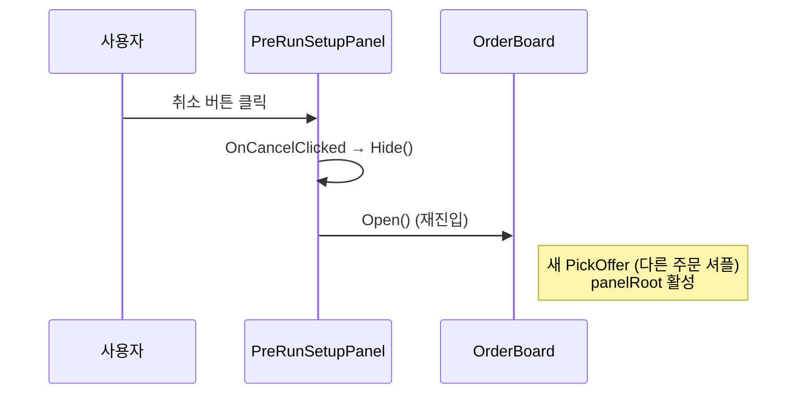

# Flow: 출발 취소

PreRunSetupPanel에서 취소 → OrderBoard 재진입.

---

## 시퀀스

---

## 거치는 함수

1. [[PreRunSetupPanel.OnCancelClicked]]
2. [[PreRunSetupPanel.Hide]]
3. [[OrderBoard.Open]] (FindFirstObjectByType로 찾음)

---

## 결과

- timeScale은 0 유지 (PSP.Show 들어가기 전 OpenBoard에서 set, 그 후 변경 없음)
- OrderBoard.Open이 새 PickOffer → **다른 주문 카드 3장 셔플**
- 사용자 인지: "왜 같은 주문 안 나와?" 가능성 (의문 항목)

---

## 의문

[[../code-review-questions]] "PSP.OnCancelClicked timeScale 복귀 누락?" 항목 — 추정 OK이지만 Play 검증 권장.
