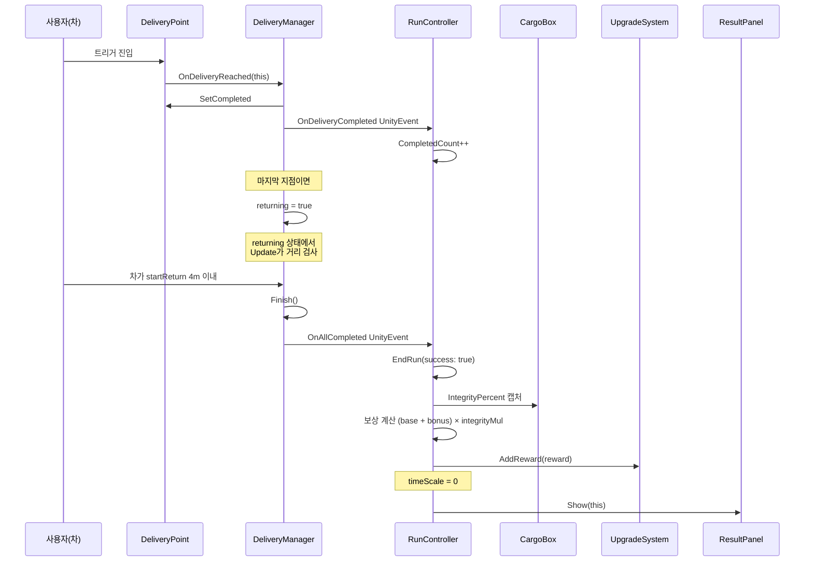

# Flow: 배달 완료 → 정산

운전 중 마지막 배달지 도달 + 복귀 → 정산 화면.

---

## 시퀀스



---

## 거치는 함수

1. DeliveryPoint 트리거 → [[DeliveryManager.OnDeliveryReached]]
2. UnityEvent OnDeliveryCompleted → RunController.OnDeliveryCompleted (CompletedCount++)
3. (마지막 점이면) returning 모드 → [[DeliveryManager.Update]] 거리 검사 → [[DeliveryManager.Finish]]
4. UnityEvent OnAllCompleted → RunController.OnAllCompleted → [[RunController.EndRun]](true)

---

## 핵심: UnityEvent 두 개

DeliveryManager → RunController 통신은 **UnityEvent 두 개**:
- `OnDeliveryCompleted(DeliveryPoint)` — 매 배달
- `OnAllCompleted` — 마지막 + 복귀 완료

RunController.Awake에서 자동 reference 잡고, BeginRun에서 `AddListener` 호출.

이렇게 **느슨한 결합**: DM은 RC를 직접 참조 안 함.

---

## 보상 계산 (성공 시)

```
reward = baseReward + (timeBonus if 시간제한)
       × integrityMul (5단계)
```

5단계:
- 100~80%: ×1.0 (완벽)
- 80~50%: ×0.8 (약간 손상)
- 50~20%: ×0.5 (크게 손상)
- 20~1%: ×0.2 (거의 전파)
- 0%: ×0.0 (전파)

---

## ResultPanel 진입 후

`resultPanel.Show(this)` → ResultPanel UI 표시 (현재 procedural Canvas, 아직 prefab화 안 됨).
사용자 "다시" 버튼 → [[RunController.RestartFromBoard]] → [[OrderBoard.Open]] 재진입.
