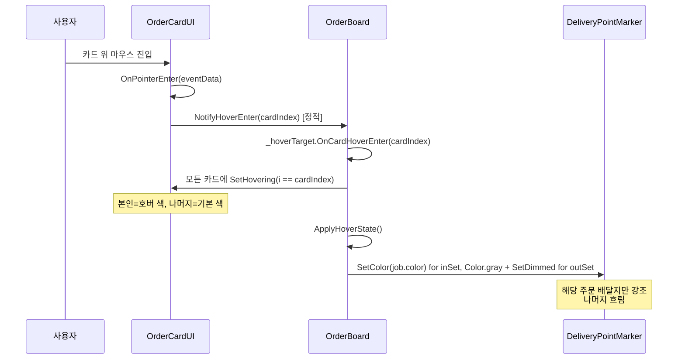
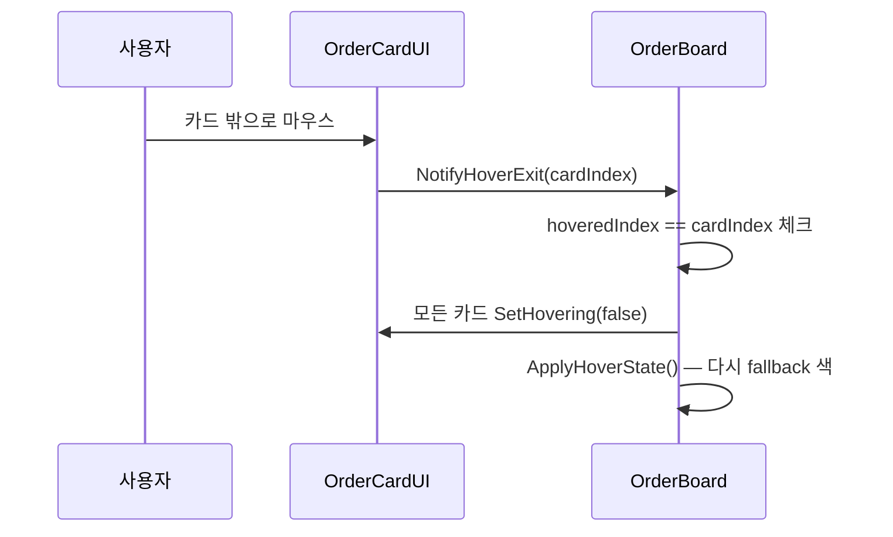

# Flow: 호버 상태 전파

사용자가 주문 카드 위에 마우스 올리면 → **카드 색 강조 + 해당 주문 배달지 마커만 색상 표시**.

---

## 시퀀스



---

## 거치는 함수

1. [[OrderCardUI.OnPointerEnter]] (Unity EventSystem)
2. [[OrderBoard.NotifyHoverEnter]] (정적)
3. [[OrderBoard.OnCardHoverEnter]] (`_hoverTarget` 라우팅)
4. [[OrderCardUI.SetHovering]] (× N)
5. ApplyHoverState (OrderBoard private) → DeliveryPointMarker.SetColor/SetDimmed

---

## 핵심: 정적 라우팅

OrderCardUI는 prefab 인스턴스 → OrderBoard ref가 인스펙터로 미리 set 안 됨.
**[[OrderBoard.NotifyHoverEnter]]가 정적**이라 어디서든 호출 가능. `_hoverTarget`이 OrderBoard 인스턴스로 라우팅.

상세: [[OrderBoard.NotifyHoverEnter]]

---

## ApplyHoverState 로직

```csharp
if (hoveredIndex < 0) {
    var fallback = GetLargestJob();  // 호버 안 함 = 가장 큰 주문 색
    각 마커에 SetColor(fallback.color), SetDimmed(false)
} else {
    var job = currentOffer[hoveredIndex];
    각 마커에 i < job.pointCount ? job.color : gray + SetDimmed(true)
}
```

**inSet 판정:** 마커 인덱스 < 호버한 주문의 pointCount. 앞에서부터 N개 마커가 그 주문에 속함.

---

## Exit 흐름



**Exit 가드** (`hoveredIndex == cardIndex` 체크): 빠르게 옆 카드로 이동 시 Exit가 늦게 와도 안 깨짐.
