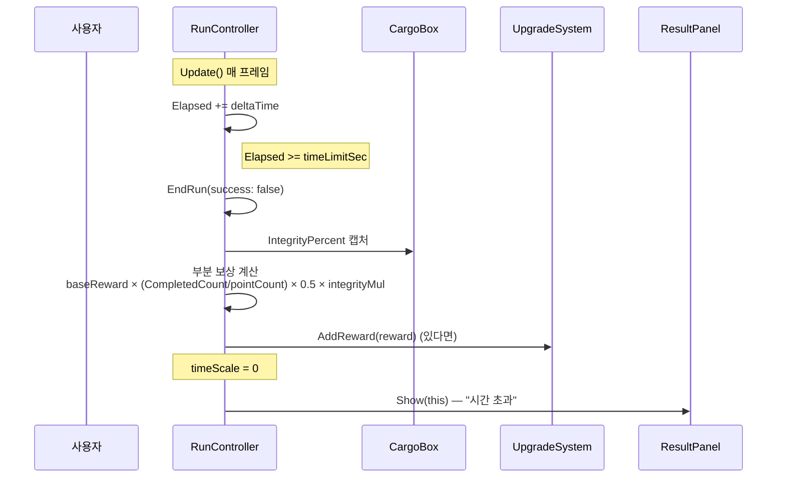

# Flow: 시간 초과 (실패)

운전 중 OrderJob.timeLimitSec 초과 → EndRun(false) → 정산 (실패).

---

## 시퀀스



---

## 거치는 함수

1. [[RunController.Update]] (시간초과 체크)
2. [[RunController.EndRun]](false)

---

## 보상 계산 (실패 시)

성공과 다르게:
```
reward = baseReward × (CompletedCount / pointCount) × 0.5
       × integrityMul
```

= 완료한 배달지 비율 × 절반 가중치 + 무결성 배율.

**0개 완료 시 reward = 0** → UpgradeSystem.AddReward는 reward > 0 가드 → 자금 변동 X.

---

## 핵심: Update 책임 분리

[[RunController.Update]] = **시간 추적**.
[[DeliveryManager.Update]] = **거리 검사** (returning 시).

둘 다 매 프레임이지만 책임 분리 명확. 중복 X, race X.
의문 [[../code-review-questions]] "Update 두 개 OK?" 항목에서 결론.

---

## ResultPanel 표시

`resultPanel.Show(this)` → 타이틀 "시간 초과" + 부분 보상 표시.
"다시" 버튼 → [[RunController.RestartFromBoard]].
